<div align="center">



<br />


<br />

<a href="https://github.com/LUBO616">
  
</a>
<a href="https://github.com/LUBO616?tab=followers">
  
</a>
<a href="https://github.com/LUBO616?tab=repositories">
  
</a>

<br /><br />

<a href="#-about-lubo">ABOUT</a> &nbsp;•&nbsp;
<a href="#-technology-stack">TECH</a> &nbsp;•&nbsp;
<a href="#-what-i-build">PROJECTS</a> &nbsp;•&nbsp;
<a href="#-security-labs">SECURITY</a> &nbsp;•&nbsp;
<a href="#-github-insights">STATS</a>

</div>

---

## 🧑‍💻 About Lubo



I'm **Lubo** — a systems engineering enthusiast focused on **Linux infrastructure, automation, containers, cloud, and cybersecurity**. I like turning repetitive tasks into reliable workflows, understanding how systems behave, and learning by building real labs.

- 🐧 **Linux administration:** Red Hat Enterprise Linux, Rocky Linux, Ubuntu, CLI troubleshooting and system hardening.
- ⚙️ **Automation:** Bash, Python, REST APIs, JSON, webhooks and workflow orchestration.
- 🐳 **DevOps & infrastructure:** Docker, Kubernetes, OpenShift, Proxmox and reproducible deployments.
- 🔐 **Security mindset:** least privilege, secrets management, security fundamentals, OSINT and CTF practice.
- ☁️ **Currently exploring:** cloud technologies, infrastructure as code, and advanced Linux administration.

> **Build what is useful. Automate what is repetitive. Secure what is important.**

---

## 🧰 Technology Stack

<div align="center">

**OPERATING SYSTEMS**


**AUTOMATION & DEVELOPMENT**


**CONTAINERS, CLOUD & INFRASTRUCTURE**


**CYBERSECURITY & PRACTICE**


</div>

---

## 🚀 What I Build

| Area | What I'm interested in |
|:---|:---|
| **Linux & Server Ops** 🐧 | Installation, configuration, storage, networking, troubleshooting and security baselines. |
| **Automation** ⚙️ | Shell scripts, reusable workflows, webhooks, task scheduling and REST integrations. |
| **Containers & Virtualization** 🐳 | Docker workloads, Kubernetes deployments and Proxmox-based homelabs. |
| **Cloud & DevOps** ☁️ | Version-controlled infrastructure, deployment practices and cloud fundamentals. |
| **Security Engineering** 🛡️ | Least privilege, secrets handling, system hardening and secure automation patterns. |

### 🧪 Homelab mindset

```text
lubo@lab:~$ ./daily-routine.sh
[ OK ] Learn something new
[ OK ] Build a repeatable lab
[ OK ] Automate the boring part
[ OK ] Break it safely and understand why
[ OK ] Document the solution
[ .. ] Keep improving
```

Explore my public work: **[GitHub repositories →](https://github.com/LUBO616?tab=repositories)**

---

## 🛡️ Security Labs

<div align="center">

`CTF` • `LINUX PRIVILEGE ESCALATION` • `OSINT` • `WEB SECURITY` • `HARDENING` • `MISCONFIGURATIONS`

</div>

My security learning path is hands-on: **Hack The Box, TryHackMe, CTF challenges and isolated labs**. I focus on understanding root causes, improving defenses, and practicing responsibly in authorized environments.

```bash
$ current_focus --list
> Linux administration and troubleshooting
> Bash / Python automation
> Container and cloud fundamentals
> Authentication, secrets and least privilege
> Web security and CTF practice
```

---

## 📊 GitHub Insights

<div align="center">


<br />


<br />


</div>

<sub>Statistics are generated by third-party services and may occasionally be unavailable. Language cards describe public repository contents, not overall skill level.</sub>

---

## 🐍 Contribution Snake

<div align="center">

<picture>
  <source media="(prefers-color-scheme: dark)" srcset="https://raw.githubusercontent.com/LUBO616/LUBO616/output/github-contribution-grid-snake-dark.svg" />
  <source media="(prefers-color-scheme: light)" srcset="https://raw.githubusercontent.com/LUBO616/LUBO616/output/github-contribution-grid-snake.svg" />
  
</picture>

<sub>Generated automatically with GitHub Actions after the workflow is enabled.</sub>

</div>

---

## ✨ A Little Inspiration

<div align="center">


<br /><br />

**`BUILD`** &nbsp;·&nbsp; **`BREAK`** &nbsp;·&nbsp; **`LEARN`** &nbsp;·&nbsp; **`REPEAT`**

<a href="https://github.com/LUBO616">
  
</a>

<br /><br />


</div>
